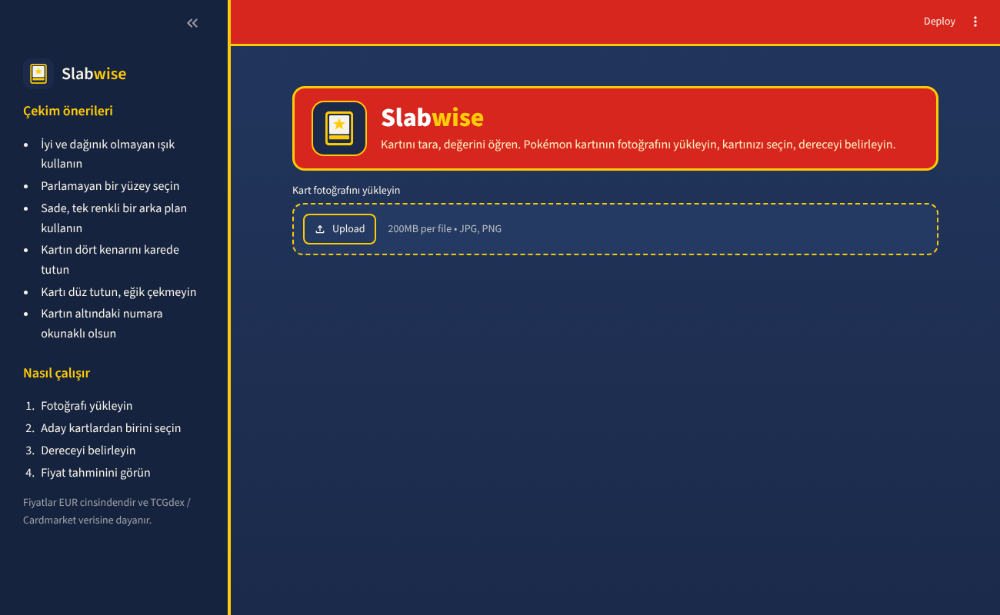
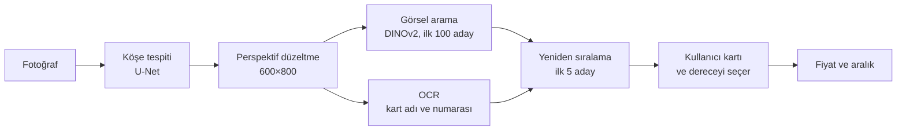

<p align="center">
  
</p>

<h1 align="center">Slabwise</h1>

<p align="center">
  <b>Kartını tara, değerini öğren.</b><br>
  Telefon fotoğrafından Pokémon kartını tanıyan ve kondisyonuna göre fiyat aralığı veren sistem.
</p>

---

## Ne yapar

Bir Pokémon kartının fotoğrafını yüklersiniz. Slabwise kartı fotoğrafta bulur, düzeltir, 21.982 İngilizce kart arasından en olası 5 adayı gösterir. Kartınızı seçip dereceyi (PSA tarzı 1–10) belirlediğinizde tahmini fiyatı ve fiyat aralığını EUR cinsinden verir.

Bu depo bir Veri Analitiği bitirme projesidir. Yöntem, sonuçlar ve sınırlılıkların ayrıntısı [proje raporunda](docs/Slabwise_Rapor.pdf) yer alır.



## Nasıl çalışır



1. **Tespit:** ResNet34 kodlayıcılı U-Net kartın maskesini çıkarır, dört köşe bulunur ve kart 600×800 boyutuna düzeltilir.
2. **Görsel arama:** Düzeltilmiş kartın DINOv2-base embedding'i, TCGdex kataloğundaki 21.982 kartın embedding'leriyle kosinüs benzerliğine göre karşılaştırılır.
3. **OCR ile yeniden sıralama:** EasyOCR kartın adını (üst bant) ve numarasını (alt bant, ör. `002/198`) okur. Ad ve numara eşleşmeleri benzerlik puanına bonus olarak eklenir. Kartların %92'si adını başka bir kartla paylaştığı için numara, aynı isimli baskıları ayırmada belirleyicidir.
4. **Fiyat:** Kartın Cardmarket referans fiyatı varsa o kullanılır. Yoksa kart özelliklerinden fiyat tahmin eden model devreye girer. Derece, kondisyon çarpanlarıyla (NM, LP, MP, HP, DMG) fiyata yansıtılır.

## Sonuçlar

### Kart tanıma

100 PSA taraması üzerinde, `python scripts\eval_scans.py` ile ölçülmüştür.

| Yöntem | İngilizce kartlar (67) top-1 | top-5 |
|---|---|---|
| Yalnızca görsel arama | 64/67 (%95,5) | 66/67 |
| Görsel arama + ad OCR | 64/67 (%95,5) | 67/67 |
| Görsel arama + ad ve numara OCR | 67/67 (%100) | 67/67 |

Bu sayıları okurken:

- Test setindeki 33 Japonca kart ayrı tutulmuştur. Katalog yalnızca İngilizce kartları içerdiği için bu kartların çoğu sistemde yoktur.
- Yeniden sıralama kuralı aynı 100 tarama üzerinde seçildi, bu yüzden %100 iyimser bir sonuçtur.
- Bunlar düz taramalardır. Telefon fotoğraflarında yalnızca 4 örnek denendi (4/4 doğru), bu geniş bir ölçüm değildir.

### Köşe tespiti

243 test fotoğrafında medyan köşe hatası 11,4 pikseldir, köşelerin %71'i 20 pikselin altında hatayla bulunur. Kart tüm fotoğraflarda tespit edilmiştir.

### Fiyat modeli

12.778 fiyatlı kart, %80 eğitim ve %20 doğrulama olarak ayrıldı. Baseline, kartın ait olduğu setin medyan fiyatıdır.

| Ölçüt | Model | Baseline |
|---|---|---|
| Medyan yüzde hata | %34,0 | %92,5 |
| Gerçek fiyatın ½–2 katı içinde kalan tahminler | %77,0 | %36,8 |
| Ortalama mutlak hata | 13,49 EUR | 20,04 EUR |
| R² (log fiyat) | 0,905 | – |

- Model tahminlerinde gösterilen aralık %80 kapsama hedefiyle hesaplanır, doğrulamada %80,1 tutmuştur.
- 100 EUR ve üzeri kartlarda (92 kart) medyan hata %57'dir. Bu tahminler arayüzde "güvenilir değil" uyarısıyla gösterilir.

## Kurulum

```
pip install -r requirements.txt
```

Model dosyaları, embedding indeksi ve ham veri boyut ve lisans nedeniyle depoda yoktur. Uygulamayı çalıştırmak için önce bunların üretilmesi gerekir, ayrıntılar [Depoda olmayan dosyalar](#depoda-olmayan-dosyalar) bölümündedir.

## Kullanım

Komutlar proje kökünden çalıştırılır.

| İş | Komut |
|---|---|
| Arayüzü aç | `streamlit run src\app\streamlit_app.py` |
| Tek fotoğraf dene | `python -m src.app.pipeline --image FOTO.jpg --grade 8` |
| Tanıma testi | `python scripts\eval_scans.py` |
| Fiyat modelini eğit | `python scripts\build_price_model.py` |
| Birim testleri | `python tests\test_pricing.py`, `python tests\test_textmatch.py`, `python tests\test_price_model.py`, `python tests\test_detection_infer.py` |

## Klasör yapısı

| Klasör | İçerik |
|---|---|
| `src/common/config.py` | Tüm yollar ve ayarlar |
| `src/detection` | Kart bulma ve perspektif düzeltme |
| `src/recognition` | OCR metni ile ad ve numara eşleştirme |
| `src/grading` | Durum notu modeli |
| `src/pricing` | Derece ve kondisyon çarpanı ile fiyat |
| `src/app` | Pipeline ve Streamlit arayüzü |
| `scripts/` | Veri toplama, model eğitimi ve değerlendirme betikleri |
| `tests/` | Birim testleri |
| `outputs/` | Çarpan tabloları ve model metrikleri |
| `eval_det_out/`, `eval_out/` | Kaggle'da üretilen değerlendirme sonuçları |
| `docs/` | Proje raporu, lisans ve atıf tablosu, ekran görüntüsü |

## Sınırlılıklar

- Katalog yalnızca İngilizce kartları kapsar.
- Derece kullanıcı tarafından girilir, fotoğraftan otomatik tahmin edilmez.
- Derece ile kondisyon arasındaki eşleme (10 → NM, 9–8 → LP, 7–6 → MP, 5–4 → HP, 3–1 → DMG) bir varsayımdır.
- Fiyatlar veri toplandığı tarihteki Cardmarket değerlerine dayanır, canlı değildir.
- Aynı kartın baskı varyantları (holo, reverse, 1. baskı) ayırt edilmez.

## Veri kaynakları

- **TCGdex:** kart kataloğu, kart görselleri ve Cardmarket EUR fiyatları.
- **JustTCG:** kondisyon bazlı fiyatlar. Depoda yalnızca türetilmiş çarpan tabloları bulunur.
- **jyesr (Hugging Face):** derecelendirilmiş kart taramaları. Lisans belirtilmediği için veri yeniden dağıtılmaz.
- **Roboflow:** kart tespiti için veri setleri (CC BY 4.0 ve Public Domain).

Lisans ayrıntıları ve atıflar [`docs/licenses.md`](docs/licenses.md) dosyasındadır. Pokémon ve kart görselleri The Pokémon Company'ye aittir. Bu proje akademik amaçlıdır ve ticari kullanım amacı taşımaz.

## Gizli bilgiler

API anahtarı yalnızca `.env` dosyasında durur ve bu dosya depoya girmez. Kurmak için `.env.example` dosyasını `.env` adıyla kopyalayıp `JUSTTCG_API_KEY` değerini yazın. Anahtar yalnızca JustTCG fiyat toplama betiği (`scripts/collect_justtcg.mjs`) için gerekir, uygulamayı çalıştırmak için gerekmez.

## Depoda olmayan dosyalar

| Yol | Neden | Nasıl elde edilir |
|---|---|---|
| `data/` | Ham veri, yeniden dağıtılamaz | `scripts/crawl_tcgdex.mjs`, `scripts/download_tcgdex_images.mjs`, `scripts/collect_justtcg.mjs` |
| `outputs/models/*.pt`, `*.joblib` | Büyük model dosyaları | Tespit modeli `src/detection/train.py`, fiyat modeli `scripts/build_price_model.py` |
| `outputs/index/` | 21.982 kartın DINOv2 embedding indeksi | TCGdex görsellerinden yeniden üretilir |
| `outputs/condition_ratios.csv` | JustTCG ham fiyatlarını içerir | `scripts/build_condition_ratios.py` |
| `outputs/index_all.csv`, `outputs/jyesr_labels.csv`, `outputs/splits/`, `outputs/eval_scans/` | jyesr verisinden türetilmiştir | `scripts/build_jyesr_index.py`, `scripts/make_grading_splits.py` |
| `outputs/synth_*/`, `outputs/demo/`, `outputs/reports/` | Kart görselleri içerir | `src/detection/synth.py` |

---

Emre Ertürk · Veri Analitiği Bitirme Projesi · 2026
